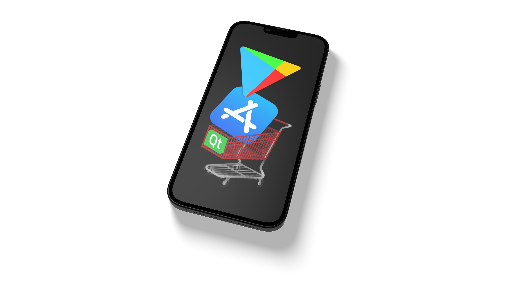

# qt6purchasing
<a name="readme-top"></a>


<!-- PROJECT LOGO -->
<br />
<div align="center">
  <a href="https://github.com/moritzstoetter/qt6purchasing">
    
  </a>

  <h3 align="center">Qt6/QML In-App-Purchasing</h3>

  <p align="center">
    Bringing In-App-Purchasing to Qt6
    <br />
    <br />
    <a href="https://github.com/moritzstoetter/qt6purchasing/issues">Report Bug</a>
    ·
    <a href="https://github.com/moritzstoetter/qt6purchasing/issues">Request Feature</a>
  </p>
</div>


<!-- TABLE OF CONTENTS -->
<details>
  <summary>Table of Contents</summary>
  <ol>
    <li>
      <a href="#about-the-project">About The Project</a>
      <ul>
        <li><a href="#built-with">Built With</a></li>
      </ul>
    </li>
    <li>
      <a href="#getting-started">Getting Started</a>
      <ul>
        <li><a href="#prerequisites">Prerequisites</a></li>
        <li><a href="#installation">Installation</a></li>
      </ul>
    </li>
    <li><a href="#usage">Usage</a></li>
    <li><a href="#contributing">Contributing</a></li>
    <li><a href="#license">License</a></li>
    <li><a href="#contact">Contact</a></li>
  </ol>
</details>


<!-- ABOUT THE PROJECT -->
## About The Project

This project provides a library wrapper, that provides an abstraction of the native app store libraries, and makes the necessary functionalities available in Qt6 and QML. Compatible with Apple App Store, Google Play Store, and Microsoft Store.

Here's why:
* In-App-Purchasing might be an important way of monetizing your Qt/QML mobile app.
* QtPurchasing didn't make it to Qt6.


<p align="right">(<a href="#readme-top">back to top</a>)</p>


### Built With

[![Qt6][qt-badge]][qt-url]<br>
[![Cpp][cpp-badge]][cpp-url]<br>
[![Objective-C][objc-badge]][objc-url]<br>
[![Java][java-badge]][java-url]<br>
[![Cmake][cmake-badge]][cmake-url]<br>

[qt-badge]: https://img.shields.io/badge/Qt/QML-6.8-20232A?style=for-the-badge&logo=qt&logoColor=41cd52
[qt-url]: https://www.qt.io/product/qt6
[cpp-badge]: https://img.shields.io/badge/C++-20-20232A?style=for-the-badge&logo=cplusplus&logoColor=blue
[cpp-url]: https://isocpp.org/
[objc-badge]: https://img.shields.io/badge/Objective--C-20232A?style=for-the-badge&logo=apple&logoColor=gold
[objc-url]: https://developer.apple.com/library/archive/documentation/Cocoa/Conceptual/ProgrammingWithObjectiveC/Introduction/Introduction.html
[java-badge]: https://img.shields.io/badge/Java-20232A?style=for-the-badge
[java-url]: https://java.com
[cmake-badge]: https://img.shields.io/badge/Cmake-20232A?style=for-the-badge&logo=cmake&logoColor=white
[cmake-url]: https://cmake.org

<p align="right">(<a href="#readme-top">back to top</a>)</p>


<!-- GETTING STARTED -->
## Getting Started

To add In-App-Purchasing capabilities to your Qt6/QML project follow the steps below.

### Prerequisites

* Qt/QML 6 (6.8 or higher)
* Apple StoreKit (iOS)
* Google Play Billing Library 8.0 or later (Android)
* Windows SDK with WinRT support (Windows)

### Installation

1. Clone this repo into a folder in your project.
  ```sh
  git clone https://github.com/moritzstoetter/qt6purchasing.git
  ```
2. For Android, set up your app's Android package as described in [Android/Google Play Setup](#androidgoogle-play-setup).
3. Add the qt6purchasing library's QML plugin to your project. In your project's `CMakeLists.txt` add the following:
   1. Ensure your project applies Qt 6.8 policies.
      ```cmake
	  qt_standard_project_setup(REQUIRES 6.8)
      ```
   2. Make this library's QML components available in the same build folder as all your own.
      ```
	  set(QT_QML_OUTPUT_DIRECTORY ${CMAKE_BINARY_DIR})
      ```
   3. Add this library to your build, using the folder you cloned it into.
      ```cmake
      add_subdirectory(qt6purchasing/src)
      ```
   4. Link your app target to this library's QML module.
      ```cmake
      target_link_libraries(APP_TARGET
          PRIVATE
              ...
              qt6purchasinglibplugin
      )
      ```

<p align="right">(<a href="#readme-top">back to top</a>)</p>

## Android/Google Play Setup

### Java Helper Class

The Android backend uses a Java class, `GooglePlayBilling`, which has to be compiled into your app. It is at `src/android/GooglePlayBilling.java` in this repo, in the package `io.github.moritzstoetter.qt6purchasing`.

The simplest way to include it is to let the library add it. After `add_subdirectory()`, call this instead of setting `QT_ANDROID_PACKAGE_SOURCE_DIR` yourself:

```cmake
qt6purchasing_set_android_package_source_dir(APP_TARGET android)
```

`android` is your app's own Android folder (`AndroidManifest.xml`, `build.gradle`, `res/` and so on), relative to the `CMakeLists.txt` that calls the function. When CMake configures, the function copies that folder into the build directory, adds `GooglePlayBilling.java`, and sets `QT_ANDROID_PACKAGE_SOURCE_DIR` to the copy. It does nothing on other platforms, so it can be called unconditionally.

To copy the file by hand instead, put it at `src/io/github/moritzstoetter/qt6purchasing/GooglePlayBilling.java` inside your Android package source directory, and copy it again whenever you update this library. Don't change its `package` line, because the library looks up the class by that name.

For more on custom Java code in a Qt Android app, see [Deploying an Application on Android](https://doc.qt.io/qt-6/deployment-android.html).

### Google Play Billing Library

The Java class needs the [Google Play Billing Library](https://developer.android.com/google/play/billing/integrate), version 8.0 or later. Add it to the `dependencies` block of the `build.gradle` in your app's Android folder:

```gradle
implementation 'com.android.billingclient:billing:9.1.0'
```

If your Android folder has no `build.gradle` yet, start from the one in Qt's Android templates, at `src/android/templates/build.gradle` in your Qt for Android kit. Google Play stops accepting new apps and updates built with older Billing Library versions. Its [deprecation timeline](https://developer.android.com/google/play/billing/deprecation-faq) lists the dates.

With Qt 6.8, the build then fails with "Duplicate class kotlin…". The Billing Library's dependencies bring in the older `kotlin-stdlib-jdk7` and `kotlin-stdlib-jdk8` modules. Their classes are already part of `kotlin-stdlib` 1.8, which Qt 6.8's template brings in. Exclude the older modules in the same `build.gradle`:

```gradle
configurations.all {
    exclude group: 'org.jetbrains.kotlin', module: 'kotlin-stdlib-jdk7'
    exclude group: 'org.jetbrains.kotlin', module: 'kotlin-stdlib-jdk8'
}
```

Qt 6.12 doesn't need this.

<p align="right">(<a href="#readme-top">back to top</a>)</p>

## Windows/Microsoft Store Setup

### Required COM Apartment Initialization

For Windows applications using Microsoft Store integration, you **must** initialize COM apartment mode in your application's `main.cpp`:

```cpp
#include <QGuiApplication>
#include <QQmlApplicationEngine>

#ifdef Q_OS_WIN
#include <windows.h>
#include <winrt/base.h>
#endif

int main(int argc, char *argv[])
{
    QGuiApplication app(argc, argv);

#ifdef Q_OS_WIN
    // CRITICAL: Fix COM apartment initialization for WinRT
    try {
        winrt::uninit_apartment();
        winrt::init_apartment(); // Defaults to multi-threaded
    } catch (...) {
        // Continue anyway - some functionality might still work
    }
#endif

    QQmlApplicationEngine engine;
    engine.loadFromModule("YourModule", "Main");
    return app.exec();
}
```

**Why this is required:**
- Qt initializes COM in single-threaded apartment mode
- WinRT Store APIs require multi-threaded apartment mode
- This must be done at the process level before any WinRT usage
- Without this, Store API calls will hang indefinitely

### Microsoft Store Product Configuration

Windows products require both a generic `identifier` and a Microsoft-specific `microsoftStoreId`:

```qml
Qt6Purchasing.Product {
    identifier: "premium_upgrade"        // Generic cross-platform identifier
    microsoftStoreId: "9NBLGGH4TNMP"    // Store ID from Microsoft Partner Center
    type: Qt6Purchasing.Product.Unlockable
}
```

The `microsoftStoreId` should be the exact Store ID from your Microsoft Partner Center add-on configuration.

### Windows Store Product Types

- **Durable** → Maps to `Product.Unlockable` (non-consumable, purchased once)
- **UnmanagedConsumable** → Maps to `Product.Consumable` (can be repurchased after consumption)

### Consumable Fulfillment

The library automatically handles consumable fulfillment for Microsoft Store. When you call `store.finalize(transaction)` on a consumable purchase, the library reports fulfillment to Microsoft Store with a unique tracking ID, allowing the user to repurchase the same consumable.

### Store Lifetime

Any Store operations that are in progress when `Store` is unloaded block its teardown until they complete. Most are short (0.1 - 2s), but for a purchase, 
the Microsoft Store payment dialog blocks teardown indefinitely, until the user dismisses it. Keeping the `Store` alive for the application's lifetime is recommended.

<p align="right">(<a href="#readme-top">back to top</a>)</p>

## Cross-Platform Transaction Processing Control (Critical)

All platforms require controlled transaction processing to prevent race conditions between transaction arrival and product registration. This uses a two-phase approach:

### Phase 1: Early Initialization in main.cpp (iOS Only)

iOS requires early transaction observer initialization to capture startup transactions:

```cpp
#include <QGuiApplication>
#include <QQmlApplicationEngine>

#ifdef Q_OS_IOS
#include "apple/appleappstorebackend.h"
#endif

int main(int argc, char *argv[])
{
    QGuiApplication app(argc, argv);
    
#ifdef Q_OS_IOS
    // Critical: Initialize iOS IAP observer before QML engine creation
    AppleAppStoreBackend::initializeEarlyTransactionQueue();
#endif
    
    QQmlApplicationEngine engine;
    engine.loadFromModule("YourModule", "Main");
    return app.exec();
}
```

**Note**: Android and Windows do not require early initialization as they handle transactions differently.

### Phase 2: Enable Transaction Processing in QML (All Platforms)

After all products are added to your Store, call `enableProcessing()` to allow transaction processing:

```qml
Store {
    id: store

    // Cross-platform transaction processing state
    property bool processingEnabled: false
    readonly property int expectedProductCount: 5  // Update with your actual product count

    Product { identifier: "product1"; type: Product.Consumable
        onStatusChanged: store.tryEnableProcessing()
    }
    Product { identifier: "product2"; type: Product.Unlockable
        onStatusChanged: store.tryEnableProcessing()
    }
    // ... more products

    // Transaction processing control functions
    function isReadyForProcessing() {
        return connected && getRegisteredProductCount() >= expectedProductCount
    }

    function getRegisteredProductCount() {
        var count = 0
        for (var i = 0; i < productsQml.length; i++) {
            var product = productsQml[i]
            if (product.status === Product.Registered || product.status === Product.Unknown) {
                count++
            }
        }
        return count
    }

    function tryEnableProcessing() {
        if (processingEnabled) return

        if (isReadyForProcessing()) {
            enableProcessingNow()
        }
    }

    function enableProcessingNow() {
        if (processingEnabled) return

        console.log("Enabling transaction processing - all products ready")
        processingEnabled = true
        enableProcessing()  // Call the library method
    }

    // Safety fallback timer (5 seconds)
    Timer {
        interval: 5000
        running: !processingEnabled
        onTriggered: {
            if (!processingEnabled) {
                console.warn("Timeout waiting for products - enabling processing anyway")
                enableProcessingNow()
            }
        }
    }

    Component.onCompleted: tryEnableProcessing()
    onConnectedChanged: if (connected) tryEnableProcessing()
}
```

**Why this controlled processing approach is required:**

**Cross-Platform Race Condition Prevention:**
- **iOS**: Early transactions from app startup need to be queued until products are ready
- **Android**: Google Play callbacks can arrive before product registration completes
- **Windows**: Microsoft Store completion handlers can fire before product validation

**QML Component Timing Issues:**
- QML Component.onCompleted execution order is officially undefined
- Product registration happens asynchronously after store connection
- Transaction signals emitted before products exist cause "Failed to map purchase to product" errors

**Platform-Specific Behavior:**
- **iOS**: Queues early transactions, processing them when enabled. Does not automatically restore purchases on startup.
- **Android**: Queues Google Play callbacks, processing them when enabled. Automatically queries purchases on connection (individual `purchaseRestored` signals are queued, but `restorePurchasesSucceeded`/`restorePurchasesFailed` signals may fire before processing is enabled).
- **Windows**: Queues Store completion events, processing them when enabled. Automatically restores purchases after product query completes (`purchaseRestored` and `restorePurchasesSucceeded` signals are queued, but `restorePurchasesFailed` signal may fire before processing is enabled).

<p align="right">(<a href="#readme-top">back to top</a>)</p>


<!-- USAGE EXAMPLES -->
## Usage

1. In your QML file include the purchasing module:
  ```qml
  import Qt6Purchasing
  ```
2. Use it like this, for a product that is called "test_1" in the app store(s):
  ```qml
  Qt6Purchasing.Store {
    id: iapStore
    Qt6Purchasing.Product {
      id: testingProduct
      identifier: "test_1"
      type: Qt6Purchasing.Product.Consumable
    }
  }

  StoreItem {
    id: testingStoreItem
    product: testingProduct

    onIapCompleted: root.accepted()
  }
  ```
  `StoreItem.qml`:
  ```qml
  import Qt6Purchasing

  Item {
    id: root
    required property Qt6Purchasing.Product product

    signal iapCompleted

    enum PurchasingStatus {
        NoPurchase,
        PurchaseProcessing,
        PurchaseSuccess,
        PurchaseFail
    }
    property int purchasingStatus: StoreItem.PurchasingStatus.NoPurchase

    function purchase() {
        purchasingStatus = StoreItem.PurchasingStatus.PurchaseProcessing
        product.purchase()
    }

    function finalize(transaction) {
        purchasingStatus = StoreItem.PurchasingStatus.PurchaseSuccess
        iapStore.finalize(transaction)
    }

    Connections {
        target: product
        function onPurchaseSucceeded(transaction) {
            finalize(transaction)
        }
        function onPurchaseRestored(transaction) {
            finalize(transaction)
        }
        function onPurchaseFailed(error, platformCode, message) {
            purchasingStatus = StoreItem.PurchasingStatus.PurchaseFail
        }
        function onConsumePurchaseSucceeded(transaction) {
            root.iapCompleted()
        }
    }
  }
  ```
3. **Important**: Call `store.finalize(transaction)` in **both** `onPurchaseSucceeded` and `onPurchaseRestored` handlers. This ensures:
   - **Consumables** are properly consumed and can be repurchased
   - **Durables/Unlockables** complete their transaction acknowledgment
   - Platform backends handle the finalization appropriately for each product type

## Monitoring Restore Progress and Errors

The Store component provides signals to monitor restore operations and handle errors:

```qml
Qt6Purchasing.Store {
    id: iapStore

    onRestorePurchasesSucceeded: (count) => {
        console.log("Restore completed successfully. Count:", count)
        if (count === 0) {
            console.log("No previous purchases found")
        } else {
            console.log(count + " purchase(s) restored")
        }
    }

    onRestorePurchasesFailed: (error, platformCode, message) => {
        console.error("Restore failed:", message)
        console.error("Error type:", error, "Platform code:", platformCode)
    }

    // Individual restored purchases still arrive via Product.onPurchaseRestored
    // Handle them in your Product's onPurchaseRestored handler
}
```

**Important notes:**
- `restorePurchasesSucceeded(count)` is emitted when restore completes, even if count is 0
- Individual restored purchases are delivered via `Product.onPurchaseRestored`
- `isRestoringPurchases` property tracks restore operation state
- The Store automatically prevents concurrent restore operations

### Platform-specific restore behaviors

**Automatic vs Manual Restore:**
- **iOS**: Manual only. Call `store.restorePurchases()` when needed (e.g., from a "Restore Purchases" button). Wait until after `enableProcessing()` has been called to ensure proper signal delivery.
- **Android**: Automatic on connection. Also supports manual `store.restorePurchases()` calls. Note that automatic restore on startup may emit `restorePurchasesSucceeded`/`restorePurchasesFailed` before processing is enabled, though individual `purchaseRestored` signals are queued properly.
- **Windows**: Automatic after product query. Also supports manual `store.restorePurchases()` calls. Note that automatic restore on startup may emit `restorePurchasesFailed` before processing is enabled; `restorePurchasesSucceeded` and individual `purchaseRestored` signals are queued properly.

**Platform APIs:**
- **iOS**: `SKPaymentQueue.restoreCompletedTransactions()`. Reports success when restore completes, even if 0 purchases found.
- **Android**: `queryPurchasesAsync()` for INAPP purchases. Failure indicates billing service issue (network, disconnected service, etc.).
- **Windows**: `GetUserCollectionAsync()`. Queries user's product collection from Microsoft Store.


## Edge Cases and Platform-Specific Behaviors

Understanding these scenarios is critical for robust production deployment:

### 1. Pending/Deferred Purchases (Ask to Buy)
**What happens**: Purchase requires external approval (parental consent, payment verification).

**Platform notes**:
- **iOS**: `SKPaymentTransactionStateDeferred` triggers pending state for Ask to Buy scenarios.
- **Android**: Family-managed accounts with purchase approval requirements trigger pending state.
- **Windows**: Microsoft family accounts with purchase restrictions cause deferred purchases.

**Library behaviour**: Automatically detects deferred transactions and emits `purchasePending` signal. The platform keeps the transaction in queue awaiting approval.

**Developer action**: Handle `onPurchasePending` to update UI showing "awaiting approval" state. Do not grant content. Wait for final `onPurchaseSucceeded` or `onPurchaseFailed` callback.

### 2. Network Interruption During Purchase
**What happens**: Purchase starts but network fails mid-transaction.

**Platform notes**:
- **iOS**: Transaction may remain in `SKPaymentTransactionStatePurchasing` indefinitely until network recovers.
- **Android**: Returns `BillingResponseCode.SERVICE_UNAVAILABLE` or similar network errors.
- **Windows**: Store API calls timeout and purchase dialog may remain open.

**Library behaviour**: Maps platform-specific network errors to `PurchaseError` enum values. Transactions may remain in purchasing state until network recovers.

**Developer action**: Handle `onPurchaseFailed` with network-related errors gracefully. Allow retry attempts. Never grant content without confirmed `onPurchaseSucceeded`.

### 3. App Crashes During Transaction Processing
**What happens**: Transaction completes on platform side but app crashes before calling `store.finalize(transaction)`.

**Platform notes**:
- **iOS**: Unfinished transactions remain in `SKPaymentQueue` and are redelivered on app launch.
- **Android**: Unacknowledged purchases remain available via `queryPurchases()` on startup.
- **Windows**: Unfulfilled consumables remain in purchase history until consumed.

**Library behaviour**: Automatically detects unfinished transactions on next app launch. **iOS** delivers them via `purchaseSucceeded` signal (same as new purchases). **Android** & **Windows** delivers them via `purchaseRestored` signal, as they both perform an automatic "Restore Purchases" during startup. This maintains transaction queue integrity across app sessions.

**Developer action**: Always handle both `onPurchaseSucceeded` and `onPurchaseRestored` identically - they both deliver transactions that need fulfillment. Call `store.finalize(transaction)` in both handlers. Implement idempotent content delivery - check if user already has the purchased item before granting it again.

### 4. Consumable Purchase Without Consumption
**What happens**: Purchase succeeds but `store.finalize(transaction)` is never called (due to app crashes, network issues, or code bugs).

**Platform notes**:
- **iOS**: Blocks future purchases of same consumable with "already owned" error until consumed.
- **Android**: Similar blocking behavior - consumable marked as owned until acknowledged.
- **Windows**: Consumable fulfillment not reported to Store, may prevent repurchase.

**Library behaviour**: Preserves transaction data and platform purchase state. On next app launch, unfinalized consumables are delivered via the purchase restore process (see scenario 3 above). The library treats restored consumables the same as any other restored purchase.

**Developer action**: **ALWAYS** call `store.finalize(transaction)` in both `onPurchaseSucceeded` AND `onPurchaseRestored` handlers for consumables. This ensures consumables are finalized even if the app crashed after purchase. Implement consumption tracking to ensure no consumables are left unfinalized.

### 5. Promotional/Offer Code Redemption
**What happens**: User redeems offer code directly from platform store, bypassing your app's purchase flow.

**Platform notes**:
- **iOS**: App Store promotional codes trigger transaction observer without app-initiated purchase.
- **Android**: Play Store promotional codes and Play Pass redemptions trigger purchase callbacks.
- **Windows**: Microsoft Store promotional codes trigger purchase notifications.

**Library behaviour**: Delivers promotional purchases through normal `purchaseSucceeded` signal flow. No special handling required from library perspective.

**Developer action**: Handle unexpected `onPurchaseSucceeded` calls that weren't initiated by your app's UI. Don't assume all purchases originate from user tapping your purchase buttons.

### 6. Platform Store Maintenance/Downtime
**What happens**: Platform store services are temporarily unavailable.

**Platform notes**:
- **iOS**: App Store downtime typically causes `NetworkError` or `UnknownError` rather than specific service unavailable errors.
- **Android**: Google Play Billing service interruptions mapped to `ServiceUnavailable` for billing disconnections.
- **Windows**: Microsoft Store maintenance periods mapped to `ServiceUnavailable` for server errors and store disconnections.

**Library behaviour**: Maps platform service errors to appropriate `PurchaseError` values. Maintains app stability during store outages.

**Developer action**: Handle `onPurchaseFailed` with service-related errors gracefully. Show user-friendly "store temporarily unavailable" messages. Implement retry mechanisms with reasonable delays.

### 7. Restore Purchase Edge Cases
**What happens**: Restore purchases doesn't return all expected results due to account, platform, or network limitations.

**Platform notes**:
- **iOS**: Cross-device restore requires same Apple ID and account mismatches prevent some restores. Network failures during restore trigger `restorePurchasesFailed`. Restore is manual only - not called automatically on startup.
- **Android**: Restore works via Google account and purchase history is tied to specific Google account. Billing service disconnection or network issues cause restore failures. Automatically queries purchases when billing service connects.
- **Windows**: Microsoft account-based restore with purchases tied to specific Microsoft account and device family. Store API errors are reported via `restorePurchasesFailed`. Automatically restores purchases after initial product query.

**Library behaviour**:
- **Windows**: Automatically calls restore after product query completes. Restore signals `purchaseRestored` and `restorePurchasesSucceeded` are queued, but `restorePurchasesFailed` may be emitted before `enableProcessing()`.
- **Android**: Automatically queries purchases on billing service connection. Individual `purchaseRestored` signals are queued, but `restorePurchasesSucceeded`/`restorePurchasesFailed` may be emitted before `enableProcessing()`.
- **iOS**: Does not automatically restore. Call `store.restorePurchases()` manually (after `enableProcessing()` has been called).
- All platforms deliver available restored purchases via `purchaseRestored` signals
- Emits `restorePurchasesSucceeded(count)` when restore completes successfully (count may be 0)
- Emits `restorePurchasesFailed(error, platformCode, message)` on errors (network, authentication, service unavailable, etc.)
- Logs warnings for purchases that cannot be mapped to registered products
- Automatically prevents concurrent restore operations via `isRestoringPurchases` property

**Developer action**:
- Handle both `onRestorePurchasesSucceeded` and `onRestorePurchasesFailed` signals
- Treat 0 count as valid success case (no purchases to restore)
- For Android: Be aware that completion signals may arrive before `enableProcessing()`, though individual restores will be queued
- For iOS: Call `store.restorePurchases()` after `enableProcessing()` for best results
- Show user-friendly error messages for restore failures
- Inform users about account requirements for restore (same Apple ID, Google account, Microsoft account)
- Don't assume restore will return all historical purchases
- Check `isRestoringPurchases` property if you need to prevent UI actions during restore

### 8. Development vs Production Environment Differences
**What happens**: Different behavior between testing and production deployments.

**Platform notes**:
- **iOS**: Sandbox environment doesn't support Ask to Buy testing and receipt validation differs from production.
- **Android**: Testing tracks have different validation requirements and purchase flows than production.
- **Windows**: Debug/development apps have different Store integration behavior than published apps.

**Library behaviour**: Works in both sandbox/testing and production environments. Provides same API surface across environments.

**Developer action**: Test thoroughly in production environment before release. Document sandbox limitations for your QA team. Be aware that some features (like iOS Ask to Buy) cannot be tested in sandbox environments.

## Thread Safety

**Important**: Store backends must be created and destroyed on the main thread. The library uses static instances internally for routing platform callbacks, which requires main-thread access for thread safety.

In QML, this happens automatically since QML components are created on the main thread.

<p align="right">(<a href="#readme-top">back to top</a>)</p>


<!-- CONTRIBUTING -->
## Contributing

Any contributions you make are **greatly appreciated**.

If you have a suggestion that would make this better, please fork the repo and create a pull request. You can also simply open an issue with the tag "enhancement".
Don't forget to give the project a star! Thanks again!

1. Fork the Project
2. Create your Feature Branch (`git checkout -b feature/AmazingFeature`)
3. Commit your Changes (`git commit -m 'Add some AmazingFeature'`)
4. Push to the Branch (`git push origin feature/AmazingFeature`)
5. Open a Pull Request

<p align="right">(<a href="#readme-top">back to top</a>)</p>


<!-- LICENSE -->
## License

Distributed under the MIT License. See `LICENSE.txt` for more information.

<p align="right">(<a href="#readme-top">back to top</a>)</p>


<!-- CONTACT -->
## Contact

Moritz Stötter - [moritzstoetter.dev](https://www.moritzstoetter.dev) - hi@moritzstoetter.dev


<p align="right">(<a href="#readme-top">back to top</a>)</p>
